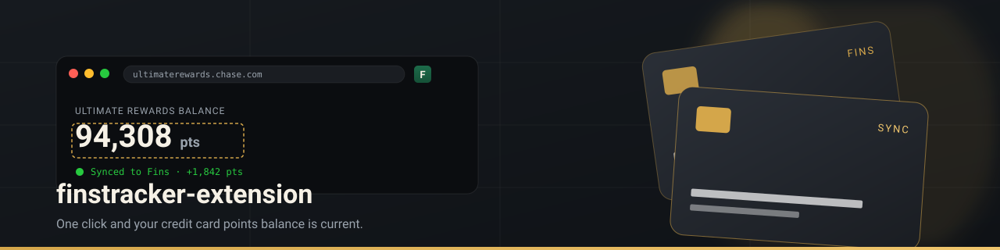

<p align="center">
  
</p>

<h1 align="center">Finstracker Sync</h1>

<p align="center">
  A Chrome (Manifest V3) extension for <a href="https://finstracker.com">finstracker.com</a>: keep card points current, use your credits and offers before they lapse, and know which card to pay with.
</p>

<p align="center">
  <a href="https://finstracker.com"></a>
  <a href="https://finstracker.com/docs-extension.html"></a>
  <a href="LICENSE"></a>
</p>

---

## What it does

The toolbar icon opens a side panel styled like the Finstracker dashboard:

- **Cards.** Every card with its balance. Open a card to update its points from the issuer's site, sync its merchant offers, read the tab you have open, or pick where the balance sits on the page.
- **Credits.** Unused statement credits, soonest first, with **Mark used** (and Undo).
- **Offers.** Active merchant offers, with **Mark used**.
- **Pay with.** On a known shop (Amazon, DoorDash, Delta, Netflix and about 150 others) the panel ranks your cards by what they earn there, using each card's earn rates and point value, and lists any saved offers for that merchant. The toolbar icon shows the best rate, for example `4×`.
- **Best card at checkout** (off by default). Turn it on in Settings and allow site access, and a small note on cart and checkout pages says which card to use.
- **Sync prompt.** On Chase, Amex, Capital One, Citi and other issuer sites, a prompt offers to sync the card's balance from the page you are on.

## Install

You need [git](https://git-scm.com/downloads) and a Chromium browser (Chrome, Edge, Brave, Arc, Vivaldi).

```bash
git clone https://github.com/egomez3412/finstracker-extension.git
```

1. Open `chrome://extensions` and turn on **Developer mode**.
2. Click **Load unpacked** and choose the `finstracker-extension/` folder (the one with `manifest.json`).
3. Pin **Finstracker Sync** from the puzzle-piece menu.
4. Click the icon, then **Sign in on finstracker.com**. You sign in on the website (password, Google, Turnstile), and the panel fills in once you are done.

To update: `git pull`, then click **Reload** on the extension in `chrome://extensions`. Settings and saved balance spots are kept.

## Quick tab

Close the sync prompt on a card's site and a small Finstracker tab stays on the edge of the page (and on the site's other pages). Drag it anywhere along the left or right edge; it remembers the spot. Click it for **Sync points/cash back**, **Pick the balance**, **Sync offers**, **Sync benefits**, **Run autopilot**, **Open Finstracker** (the side panel) or **Hide on this site**. Settings has a switch for it and brings it back on hidden sites.

## Autopilot

On a card site, the Finstracker popup names your cards that use the site ("3 of your cards use americanexpress.com: Gold, Platinum, Blue Cash") and offers **Run autopilot for 3 cards**. It runs in that tab. When several cards share a site, autopilot selects each card in the site's own card switcher before reading its balance, offers and benefits. If a card can't be selected on the offers or benefits page, that step is skipped for the card rather than saving another card's data. A short summary, one line per card, shows on the page at the end. The quick tab has the same **Run autopilot for all**.

**Run autopilot** (on a card, or for all cards at the top of Your cards) goes through the issuer's pages in one tab and updates everything for each card:

1. **Balance**: points, or cash back for cash back cards (Amex "Reward Dollars", Discover "Cashback Bonus", "cash back"), plus new **points activity** lines ("Nov 8 · Dining · +500 pts") recorded as their own entries. The first read of a card only notes what is already there, so nothing is counted twice.
2. **Offers**: clicks **Add to Card** on every offer tile (only inside offer tiles, never page buttons like "Add card"), then saves all offers to that card in Finstracker, marking the ones on the card. Banks without a known offers page are reached through their own "Offers" link.
3. **Benefits**: reads the benefits page ("Uber Cash · $10 of $10 used", "$0 remaining", "Completed") and marks the matching credits used in Finstracker.

Turn on **Daily autopilot** on a card and **Settings › Daily autopilot when signed in**, and it runs by itself once a day in a background tab while you are signed in to the card's site. A background run never waits: if a page needs a sign-in or your OK, it notes that and moves on.

Each step also has its own button on the card: **Update points/cash back**, **Sync offers**, **Sync benefits**.

## How a points sync works

1. **Update points** uses a tab that is already on the card's site. Otherwise it opens the page where the balance was found last time, or the sign-in page of the site that holds the points. Co-branded cards go to the airline or hotel (Delta, United, Southwest, American, Alaska, JetBlue, Aeroplan, British Airways, Flying Blue, Marriott, Hilton, Hyatt, IHG, Wyndham, Choice, Amazon, Bilt); other cards go to their bank (Amex, Chase, Capital One, Citi, Discover, Wells Fargo, Bank of America, U.S. Bank, Barclays). **Read this tab** does the same on the tab you are looking at.
2. A small Finstracker note on the page says what is happening. On a sign-in or verification page it waits for you; passwords, passkeys and codes are yours to enter.
3. Once you are in, it reads the page. No balance there → it opens the card's rewards page, then follows the site's own rewards links ("Ultimate Rewards", "SkyMiles", "View rewards"), up to three steps, on the same site only.
4. It prefers numbers next to the card's name and program, so a page listing several cards gives each card its own number. Dollar amounts, statement balances and masked account numbers are skipped.
5. The first time, the number is highlighted and the note asks **Is this your balance?** (also shown in the side panel). **Use it** posts the difference to Finstracker; **Pick another** lets you click the right number. That spot is then trusted, and later syncs post without asking.

**Pick the balance** walks you through it. From any tab, it takes you to the card's site and opens the picker once you have signed in. Step 1 lists the likeliest numbers (numbered on the page too); click one, press its number key, or click the balance itself. Hovering shows the number that would be picked. Step 2 asks "Use 98,765 for Sapphire Preferred?". **Not on this page** opens the card's rewards page and the picker comes back there.

**Use this tab** makes the open page a card's rewards page. Pages and spots are remembered per card; **Settings › Rewards pages › Reset** forgets them.

## Code layout

No build step: the folder is the extension.

```text
manifest.json
background.js              Service worker: connects Chrome events to lib/worker
panel/                     Side panel (panel.html, panel.css, panel.js)
content/                   Page scripts: reader (finds balances and rewards links), status note,
                           sync prompt, checkout note, element picker
lib/
  api.js                   Finstracker REST API client
  storage.js               chrome.storage.local keys and defaults
  parse.js                 Number parsing and the earn/redeem calculation
  portals.js               Which page and selector to use for each card, and where to go next
  programs.js              Airline and hotel programs, issuer name spellings, words next to a balance
  merchants.js             Website → spending category, checkout detection, offer matching
  best-card.js             Ranking cards by value per dollar
  benefits.js              Credits, offers and annual fee summaries
  inject/offers.js         Offer-tile reader run inside issuer offer pages
  worker/                  Service worker parts: capture, offers sync, site hints, messages, sign-in
portals.json               Issuer and card presets
fonts/                     Inter and Fraunces (SIL Open Font License)
tests/                     node --test suites for the lib/ logic
```

Run the tests with Node 20 or newer:

```bash
npm test
```

End-to-end tests load the extension in Chromium and sync from a fake bank (sign-in, a dashboard without the balance, a rewards page listing two cards, strict Content-Security-Policy):

```bash
npm install && npx playwright install chromium
npm run e2e -- update
npm run e2e -- existing
npm run e2e -- picker
npm run e2e -- guided
npm run e2e -- amex     # prompt across page loads and in-app routes, Trusted Types page
npm run e2e -- wander   # moving to another page while "Is this your balance?" is up
npm run e2e -- cashback  # Reward Dollars next to a statement balance
npm run e2e -- offers    # Add to Card on each offer, not the page's own buttons; saved per card
npm run e2e -- benefits  # follows the Benefits link, marks fully used credits
npm run e2e -- activity  # baseline first, then new activity lines recorded
npm run e2e -- autopilot # balance, offers and benefits from one button
npm run e2e -- quicktab  # close the prompt, drag the tab, sync from its menu
npm run e2e -- portal    # three cards on one site with a card switcher, autopilot from the popup
```

## Security model

- The session token lives only in `chrome.storage.local` and is sent as `Authorization: Bearer …` to Finstracker. It is never put into any web page.
- Sign-in happens on finstracker.com in a normal tab, which hands the token to this extension by its ID. Only Finstracker's own origins can do that (`externally_connectable`).
- Page scripts run in the extension's isolated world (so bank pages' Content-Security-Policy cannot block them, and page scripts cannot see them) and return only the text of the balance or offer tiles. They do not read form fields, cookies or tokens.
- Host access is limited to Finstracker, the supported banks and the airline, hotel and shop programs above. Other sites are asked for one at a time, only when you use Read this tab, Pick the balance or Use this tab there. Checkout notes need broader site access, which is optional, asked for only when you turn the feature on, and given back when you turn it off.
- Finstracker re-checks every posted amount on the server (a redeem cannot exceed the balance, amounts must be valid numbers).

## Limitations

- Issuer pages change often, so the default selectors in `portals.json` go stale. **Pick the balance** fixes a card in one click.
- A balance inside a cross-origin frame may not be readable; pick it on a page where it is in the main frame.
- Best-card suggestions are only as good as the earn rates saved on each card in Finstracker.

## Related

- [finstracker.com](https://finstracker.com), the web app
- [finstracker-claude-skill](https://github.com/egomez3412/finstracker-claude-skill), your wallet from Claude
- [REST API docs](https://finstracker.com/docs-api.html)

## License

MIT. See [LICENSE](LICENSE). Fonts are under the SIL Open Font License; see `fonts/`.
